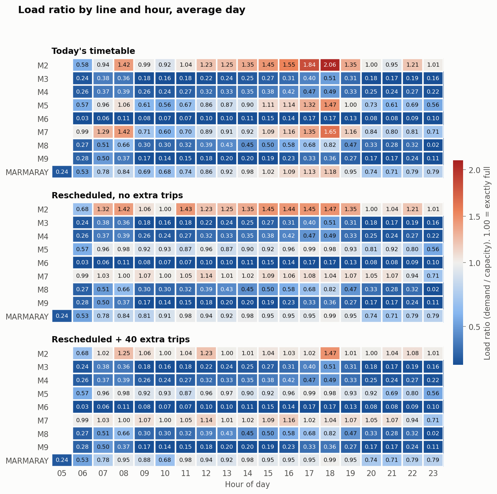
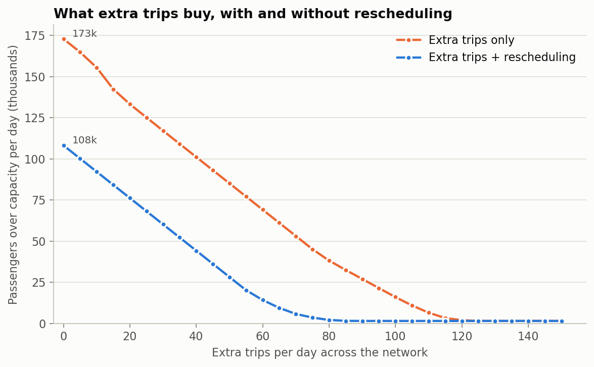
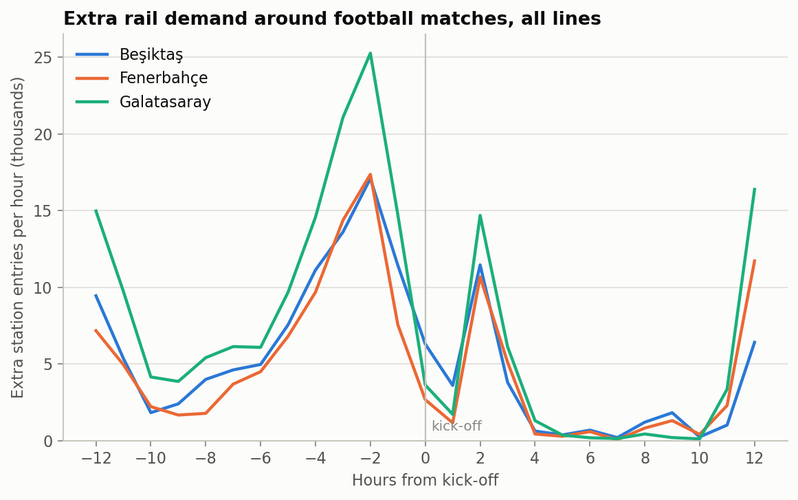

# Istanbul Rail System: Passenger Flows and Trip Frequency Optimisation

Finds where and when Istanbul's rail lines are over capacity, and computes how trips should be scheduled to relieve it, using 3.45 million hourly ridership records.

Started as the term project for YZV202E (Optimization for Data Science), Istanbul Technical University, Spring 2026.

## Main results

On an average day, 30 of 163 line-hours carry more passengers than the scheduled trains have room for. That is about 173,000 passengers over capacity per day, and the worst hour (M2 at 18:00) runs at 206% of capacity.

| Plan | Extra trips per day | Passengers over capacity | Worst load ratio |
| --- | --- | --- | --- |
| Today's timetable | 0 | 172,900 | 2.06 |
| Reschedule only (move 56 trips to other hours) | 0 | 108,200 (−37%) | 1.47 |
| Extra trips only | 40 | 101,100 (−42%) | 1.53 |
| Reschedule + extra trips | 40 | 44,200 (−74%) | 1.47 |
| Reschedule + extra trips | 60 | 14,200 (−92%) | 1.09 |

- **Rescheduling is worth about 40 extra trips.** Moving trips from quiet hours to busy hours on the same line costs no extra effort and removes as much overcrowding as adding 40 trips without rescheduling. It also removes all severe crowding (above 150% of capacity).
- **One hour cannot be fixed by frequency alone.** M2 at 18:00 would need 31 trips an hour, more than a 2-minute headway allows. About 1,500 passengers stay over capacity there under any plan.
- **Match days add 21 to 42 trips to the requirement.** Bringing every line-hour down to capacity takes 125 extra trips on a normal day, and 146 (Fenerbahçe), 150 (Beşiktaş) or 167 (Galatasaray) on a match day.





## How it works

The project is a pipeline of seven steps. Each step is one script in `src/` and writes its output to `results/`.

| Step | Script | What it does | Output |
| --- | --- | --- | --- |
| 1 | `01_station_weights.py` | Each station's share of its line's passengers, per hour | `hourly_station_weights.csv` |
| 2 | `02_estimate_od_matrix.py` | Estimates station-to-station flows from entry counts | `estimated_hourly_od_matrix.csv` |
| 3 | `03_operational_effort.py` | Train capacity and effort per trip for each line | `operational_effort_coefficients.csv` |
| 4 | `04_baseline_load_ratios.py` | Demand against scheduled capacity, per line and hour | `baseline_load_ratios.csv` |
| 5 | `05_match_day_demand.py` | Extra demand around football matches | `match_day_extra_demand.csv`, `match_day_extra_trains.csv`, `match_station_offset_features.csv` |
| 6 | `06_optimize_trips.py` | Chooses trips per line and hour | `optimized_timetable.csv`, `budget_tradeoff.csv`, `match_day_plan.csv`, `optimization_summary.json` |
| 7 | `07_make_figures.py` | Charts | `figures/` |

### Data cleaning

The raw open data lists the same physical station under several spellings. Station names were normalised with a manual map plus rules, which reduced 348 station names to 266 and 4,222,304 rows to 3,455,244 while keeping the passenger total unchanged. This is documented in `notebooks/data_cleaning_aggregation.ipynb` (notes in Turkish).

### Station-to-station flows (step 2)

The ridership data counts entries at each station but not where passengers get off. The estimator uses the fact that commuting is mirrored: a station with heavy morning entries is a residential origin and attracts evening arrivals, and the reverse holds for workplace stations. Each origin's entries are distributed over the other stations of its line in proportion to those attraction weights, so that every origin's flows add up to its real entry count. Lines with one or two stations and hours with no passengers are handled as explicit special cases. The network covered is 23 lines and 266 stations.

### Match-day demand (step 5)

For 162 matches of Beşiktaş, Fenerbahçe and Galatasaray, station entries from 12 hours before to 12 hours after kick-off are compared with the normal level for the same station, weekday and hour on days without a match. Demand rises from about six hours before kick-off, peaks two hours before, and peaks again two hours after.



### Trip frequency optimisation (step 6)

A mixed-integer linear programme, solved with the HiGHS solver through SciPy.

- **Decision:** the number of trips `x` on each line in each hour (an integer).
- **Constraints:** between a minimum service level (6 trips an hour, or today's level if lower) and 30 trips an hour (a 2-minute headway). Trains cannot move between lines, so rescheduling keeps each line's daily trip count. Extra trips are limited by a network-wide budget.
- **Objective:** minimise the number of passengers over capacity, with passengers above 150% of capacity counted double so the worst hours are relieved first. Among equally good plans, the one with the least effort and fewest timetable changes is chosen.

Four scenarios are solved: rescheduling only, extra trips only, both together, and match days. The budget is swept from 0 to 150 extra trips to produce the trade-off curve.

## Assumptions and limits

- **Demand is station entries, not passengers on board.** The load ratio divides hourly entries on a line by hourly seat-and-standing capacity. It is a consistent measure of pressure on a line, but it is not the load on the busiest section between two stations. Using the station-to-station flows from step 2 for that would need the order of stations along each line, which the data does not contain.
- **An average day.** Demand is averaged over all days in the data, weekdays and weekends together.
- **Effort is not money.** One trip is one unit of effort on every line, because per-line operating costs are not public.
- **Lines covered by the optimisation:** M2 to M9 and Marmaray, the lines with both a timetable and matching demand. M1A and M1B are left out because the ridership data does not separate the two branches.
- **Matches:** the schedule lists each club's matches without separating home and away, so the measured match-day effect is an average over both.
- **Rescheduling shifts some crowding.** It lowers the total and removes the severe cases, but a few off-peak hours end slightly above capacity (32 line-hours above 1.00 instead of 30).

## Running it

Python 3.10 or newer.

```bash
pip install -r requirements.txt
```

```bash
python run_pipeline.py
```

The ridership file is too large for the repository; `data/README.md` explains how to build it. Without it, the result files in `results/` can still be read directly, and steps 3, 6 and 7 run from the files already in the repository.

## Repository layout

```
data/        input tables and how to obtain the ridership file
src/         the seven pipeline steps
results/     every output, plus figures/
notebooks/   data cleaning and match-schedule scraping, kept as a record of how the inputs were made
```

## Team and contributions

Steps 1 to 5 were built during the course by:

- **Atillahan Gözütok**: proposed the project, data collection, station weights, flow estimation
- Emir Selim İslam
- Erdem Hasbek
- Huzeyfe Dut

Step 6 (the optimisation model), step 7 and the reorganisation into a single runnable pipeline were added by Atillahan Gözütok in November 2026, after the course.
